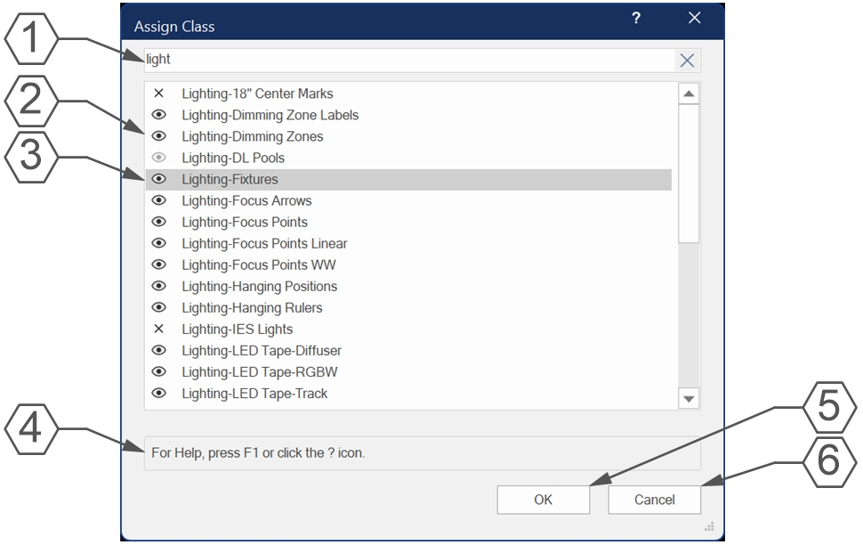

# Assign Class to Selected

Menu Command

## Version

**1.0.0** - 10/16/2026

This plug-in is written in Vectorscript (Pascal) and can be used in any version of [Vectorworks](https://www.vectorworks.net) 2019 or newer.

## Description

This menu command launches a dialog box allowing the User to choose a Class to assign to all currently selected objects. This can be useful when placed in the **Object Context** menu in the Workspace.

## Instructions

1. Select objects needing a different Class assignment.
1. Run the **Assign Class to Selected** menu command.
1. Narrow the list of Classes by entering text in the **Search Box** at the top of the dialog.
1. Select a Class.
1. Press the **OK** button to assign the chosen Class to all currently selected objects.
1. If a Group is selected, a separate dialog box will prompt whether to assign the Class to subobjects of the Group. This choice will be applied to all selected Groups.

## Dialog Box Explanation

1. **Search Box**: Enter text to narrow down the Class list. Search text is not case sensitive.
1. Class list with icon representing the current Class visibility.
1. Currently selected Class. A Class must be selected before pressing the **OK** button.
1. **Help Box**: Mousing over any dialog box element will display an explanation here.
1. Press the **OK** button to close the dialog box and assign all currently selected objects to the chosen Class.
1. Press the **Cancel** button to clsoe the dialog box without changing the Class of selected objects.

## Installation Instructions

There are two methods of installation, direct download of the plug-in or through the **JNC Tools Free Manager** plug-in.

### Direct Download:

1. Download [source plug-in file](Assign%20Class%20to%20Selected.vsm)
2. Place downloaded file inside the **Vectorworks User Folder** within the **Plug-ins** directory
3. Restart Vectorworks

### JNC Tools Free Manager

1. Run the [**JNC Tools Free Manager**](https://jncogs.github.io/JNC-Tools-Manager-Free/) menu command
2. Select the **Assign Class to Selected** command
3. Press the **Install / Update** button
4. Press **Close** to close the dialog box
5. Restart Vectorworks

## Adding the Plug-in to your Workspace

1. Open the **Workspace Editor** by going to **Tools - Workspaces - Edit Current Workspace**
2. Select the **Menus** tab
3. In the box on the left, find and expand the **JNC** category
4. In the box on the right, find a suitable menu to place the command in, such as **Edit** or **Object Context**
5. Click and drag the **Assign Class to Selected** command from the box on the left to the desired menu location in the box on the right
6. Click **OK** to close the editor

## Localization Instructions

The plug-in can be localized to your native language without having access to the source code.  This can be achieved by following the instructions below:

1. Open the **Plug-in Manager** by going to **Tools - Plug-ins - Plug-in Manager**
2. Select the **Third-party Plug-ins** tab
3. Select the **Assign Class to Selected** command
4. Click the **Customize** button
5. Select the **Strings** tab
6. Double-click a category, such as **Dialog Strings**
7. Select a string to edit and press the **Edit** button
8. Write a new string and press the **OK** button until you are back to the **Plug-in Manager**

The categories for this plug-in are as follows:

- **3000** - *Dialog Strings*: These strings are used in the diagog box and can all freely be changed.
- **4000** - *Dialog Help Strings*: These strings are used in the **Help Box** and can all freely be changed.
- **5000** - *Misc Strings*: These strings are used for multiple purposes in the code, only the following can be changed:
    - **5003**: Descend in to Groups prompt text.

## Release Notes

| Date | Version | Note |
| :---: | :---: | :--- |
| 10/16/2026 | 1.0.0 | Initial release |

## Known Bugs

No Known Bugs

## Feature Requests

No current Feature Requests

## License

Copyright (c) Jesse Cogswell (JNC Tools)

Permission is hereby granted, free of charge, to any person or organization
obtaining a copy of this software (the "User") and associated documentation files (the "Software"),
to use, reproduce, distribute, execute, and transmit the Software.

The User is not permitted to modify or attempt to reverse engineer the source code.  The User may
localize the Software using approved methods from within the Vectorworks software.

THE SOFTWARE IS PROVIDED "AS IS", WITHOUT WARRANTY OF ANY KIND, EXPRESS OR
IMPLIED, INCLUDING BUT NOT LIMITED TO THE WARRANTIES OF MERCHANTABILITY,
FITNESS FOR A PARTICULAR PURPOSE, TITLE AND NON-INFRINGEMENT. IN NO EVENT
SHALL THE COPYRIGHT HOLDERS OR ANYONE DISTRIBUTING THE SOFTWARE BE LIABLE
FOR ANY DAMAGES OR OTHER LIABILITY, WHETHER IN CONTRACT, TORT OR OTHERWISE,
ARISING FROM, OUT OF OR IN CONNECTION WITH THE SOFTWARE OR THE USE OR OTHER
DEALINGS IN THE SOFTWARE.